# 方舟 ARK 架构与维护手册

给接手的开发者。读完这份再读 `docs/HANDOFF.md`（当前进度）、`docs/DATA.md`（资料包与检索）、`docs/PLAN.md`（实测数据与决策）。
代码根目录：`app/app/src/main/java/app/ark/`（下文省略前缀）。每个源文件开头都有文件头注释，说明职责、依赖和设计原因。

## 1. 模块图

```mermaid
flowchart TB
  subgraph UI["ui/ 界面 (Compose)"]
    Root[Root.kt 五个标签页] --> Ask[AskScreen]
    Root --> Lib[LibraryScreen 资料/模型/设置]
    Root --> Map[MapScreen + MapStyle]
    Root --> Tools[ToolsScreen → ui/tools/* + ui/comm/*]
    Root --> Bm[BookmarksScreen]
    VM[AppViewModel 提问流程/下载/导入]
  end
  subgraph LLM["llm/"]
    LM[LlmManager 大模型]
    EM[Embedder 向量模型]
    PR[Prompts]
    AT[ArkTools 计算器 默认不开]
  end
  subgraph DATA["data/"]
    PRepo[PackRepository 检索]
    QA[QaStore ark.db]
    ST[Storage 文件/下载]
    TS[TrackStore] --- WP[Waypoints]
  end
  subgraph COMM["comm/ 通讯"]
    CE[CommEngine BLE 消息] --- CP[CommProto]
    AL[AcousticLink] --- AM[AcousticModem + Rs]
    AS[AlarmService]
    CS[CommService]
  end
  subgraph SENS["sensors/"]
    HD[Heading 方位融合]
    BC[Beacon + BeaconService]
    TK[TrackService]
  end
  SH[share/ ShareServer + ShareService]
  App[ArkApp 单例] --> LM & EM & PRepo & QA & ST
  VM --> LM & EM & PRepo & QA & ST
  Ask & Lib & Bm --> VM
  Map --> TS & WP & HD & BC & TK
  Tools --> HD & CE & AL & AS
  CS --> CE
  Lib --> SH
  subgraph PC["电脑端 (不进 APK)"]
    Data[data/*.py 资料包] --> Pack[(.arkpack)]
    Emb[tools/embed 写向量 / 批量评测 / 超声复盘] --> Pack
    Eval[eval/*.py 评测]
  end
  Pack -.打进 assets 或下载.-> ST
```



分层约定：`ui` → `llm`/`data`/`comm`/`sensors`；`data` 与 `llm` 不依赖 `ui`。`comm/AcousticModem.kt`、`Rs.kt`、`ModemSim.kt` 和 `llm/ArkTools.kt` 不依赖 Android，同一份源码也被 `tools/embed` 在电脑上编译使用（见 §7、§8）。

## 2. 主要数据流

### 2.1 提问 → 检索 → 生成 → 保存（`ui/AppViewModel.ask`）

1. `Embedder.query` 把问题变成 256 维向量（CPU，约几十毫秒；没装向量模型则为 null，只走关键词）。
2. 没有大模型或开了“省电模式（只检索）”：`PackRepository.search(..., 6, qvec)` 直接给 6 段，存为 `mode=search`，结束。
3. 否则 `LlmManager.ensure` 加载模型（首次 10–30 s，GPU 失败自动退 CPU）。
4. 若有启用的“检索走英文”的包（`lang` 不以 `zh` 开头，**中文显示版包的 lang 仍是 `en`**），先让模型按 `Prompts.KEYWORDS` 把中文问题改写成 3–6 个英文关键词（最多 48 token），与问题里本来就有的英文词合并。
5. `PackRepository.search`：FTS5 关键词一路 + 向量点积一路，各取前 50，RRF（k=60）合并，按开头 200 字符去重，取前 4 段。
6. 有资料 → `Prompts.RAG` + `Prompts.ragUser(资料, 问题)`，`mode=rag`；没有资料 → `Prompts.CLOSED` 闭卷，`mode=closed`。流式文本通过 `Live` 状态推给界面（约 8 次/秒）。
7. 回答像“请提供您的问题”（`Prompts.lostQuestion`）时把问题挪到资料前再问一次。
8. 存入 `QaStore`（`filesDir/ark.db`），出处原文随记录保存。界面渲染时 `Common.unverifiedNumbers` 把在出处原文和问题里找不到的数字标红（防小模型抄错剂量）。
9. 结束后 10 分钟无操作，`ArkApp.appScope` 里的计时器卸载大模型和向量模型。

关键设计：
- **GPU 激活精度默认 FLOAT32**（`LlmManager.ensure`）：运行时默认低精度会把数字抄错（146→1466），FLOAT32 实测错数 6–11 → 0，代价每问约 +9 J、+6 s。调试开关 `--es ark_act DEFAULT`。
- **贪心解码、关思考、每次新建对话不带历史**：省电且稳定。重复行检测（`LlmManager.repeatCut`）截断小模型的循环输出。
- **GPU 崩溃自愈**：初始化前写 `gpu_init_pending`（`commit()` 同步），下次启动仍为 true 即认定驱动崩溃，改默认 CPU。
- **检索用英文、显示用中文**：内置包 `meta.display=zh`；`chunks.text` 是中文译文，`chunks.text_en` 是 zlib 压缩的英文原文，FTS 索引和向量都基于英文。纯中文检索评测明显更差（HANDOFF §3b）。阅读器可切“原文/译文”。

### 2.2 资料包格式（`.arkpack`，SQLite）

详见 `docs/DATA.md`。App 侧读取的部分：

| 表 | 说明 |
|---|---|
| `meta(key,value)` | `id, title, lang, license, version, chunks`；`display=zh` 标记中文显示版；`vec_model`, `vec_dim`（必须与 `Embedder.DIM`=256 一致，否则语义一路跳过该包） |
| `docs(id,path,title,src)` | 文档 |
| `chunks(id,doc_id,seq,text,title[,text_en])` | 段落；`seq` 是文档内顺序（阅读器翻页）；`text_en` 仅中文显示版 |
| `chunks_fts` | FTS5。英文包 porter 词干；中文包 trigram（detail=none，只能查三字片段） |
| `vec(chunk_id,v)` | `v` = 4 字节小端 float 缩放系数 + 256 个 int8；点积后乘缩放 |

文件位置：内置包在 `assets/packs/`，首次启动/升级后由 `Storage.installBundledPacks` 复制到外部专属目录（SQLite 不能直接读 assets；以“目标文件修改时间 ≥ App 更新时间”判断是否已是本版）。

### 2.3 BLE 消息帧（`comm/CommProto.kt`，不配对、最多 3 跳）

发现用 BLE 广播，传输用 GATT 写入（不是纯广播）：

- 广播包：Flags + 128 位服务 UUID `6b5e0001-4152-4b00-8c3a-0f7a6c0d9e11`（扫描过滤用）。扫描响应：厂商数据，公司 ID `0xFFFF`，载荷 = `A7 43`（魔数）、版本 1、短 ID 4 字节（大端）、昵称 UTF-8 ≤12 字节。
- GATT：`RX` 特征（WRITE，带响应）对方分片写入；`ACK` 特征（NOTIFY）整条重组入库后通知 `[msgId 4][状态 1：0 新 / 1 重复 / 2 格式错误]`。
- 分片：`[xfer 1][idx 1][total 1][数据…]`，每片数据 ≤ MTU−3−3；MTU 协商失败按每片 17 字节。必须按序到达（GATT 写入本身有序）。
- 消息（重组后，全部大端）：`版本(1)=1 | flags(1: bit0 群发, bit1 带位置) | 消息ID(4,随机) | 源短ID(4) | 目的短ID(4,群发为0) | TTL(1,默认3) | 发送时间(4,UTC秒) | 昵称长度n(1,≤12) | 昵称(n) | [位置 6 字节：纬度×10000+90 / 经度×10000+180 各 3 字节，0xFFFFFF=无] | 正文 UTF-8 ≤200 字节`。
- 去重键 = (消息ID, 源)；接收方 TTL>0 时递减后转发 = 接力；界面“经 N 跳”由 `DEFAULT_TTL+1−ttl` 反推。

### 2.4 超声帧（`comm/AcousticModem.kt`、`Rs.kt`）

16-MFSK（每个音 4 bit），44.1 kHz 采样，每符号 40 ms；近超声模式 `NEAR_ULTRA`：f0 = 17 kHz，间隔 2500/15 Hz，即 17–19.5 kHz。

| 段 | 内容 |
|---|---|
| 前导 13 符号 | Barker-13（+→音 15，−→音 0）；错位得分 ≤0.5、对齐接近 1，不会锁错位置 |
| 头 12 符号 | RS(6,2)：`[长度 0..140][版本 1]` + 4 校验字节，每字节高 4 bit 先发 |
| 体 2×N 符号 | `UTF-8 载荷 + CRC16-CCITT(2 字节)`，切成 ≤48 字节的块（平均分），每块加 12 字节 RS 校验（每块可纠 6 个字节错误），各块逐字节交错（抗突发噪声） |

速率约 9–10 字节/秒；一条最多 140 字节（`MAX_BYTES`）。接收：每 1/8 符号（5 ms）做 16 点 Goertzel，用前导模板“峰值占比”打分同步（与音量无关，不需要 AGC）；门限 0.5，追到峰值后再等 8 步锁定，假同步后用环形缓冲补扫（HANDOFF §4d）。录音源优先 `UNPROCESSED`（系统降噪/AGC 会滤掉 17 kHz 以上）。复盘：`ark-embed rxfile <pcm> ultra`。

### 2.5 求救信标广播（`sensors/Beacon.kt`，不可连接广播）

Manufacturer Specific Data，公司 ID `0xFFFF`，载荷 12–24 字节（全部大端）：

| 偏移 | 长度 | 内容 |
|---|---|---|
| 0 | 1 | `0xA7` 魔数 |
| 1 | 1 | `0x4B`（'K'，与消息协议的 `0x43` 区分） |
| 2 | 1 | 高 4 位版本=1；bit0：1 求救 / 0 平安 |
| 3 | 2 | 节点 ID（安装时随机，仅用于合并同一发送者） |
| 5 | 3 | 纬度 `round((lat+90)×10000)`，`0xFFFFFF`=无定位 |
| 8 | 3 | 经度 `round((lon+180)×10000)`，`0xFFFFFF`=无定位 |
| 11 | 1 | 位置已过去的分钟数（封顶 255） |
| 12 | 0–12 | 短消息 UTF-8，按字符边界截断 |

整个 AD 结构 28 字节，加系统的 3 字节 Flags 仍在 31 字节上限内。接收端用 RSSI 估距 `d ≈ 10^((−65−RSSI)/25)`，只作粗略参考。

### 2.6 其他数据流
- 离线分享（`share/`）：手写 HTTP（GET/HEAD、Range），`/` 首页、`/apk/ark.apk`、`/pack/<名>`、`/map/<名>`；文件名只与目录列表做完全相等匹配；不分享大模型；8 并发 + 16 排队；30 分钟无请求自动关闭。
- 轨迹/航点 → `data/Gpx` 导出到系统“下载”目录（Android 10+ 走 MediaStore，9 及以下需存储权限）。
- 下载：`Storage.startDownload` 交给系统 DownloadManager，写 `<文件名>.part`，`AppViewModel.poll` 每秒查询，成功后 `finishDownload` 改名；任务 id 存 prefs，重启后继续。

## 3. 后台服务清单

清单（`AndroidManifest.xml`）声明了 6 个前台服务，全部 `exported=false`，都带通知和“停止”入口；`START_STICKY` 者为被系统杀后重启。

| 服务 | 前台类型 | 何时启动 | 何时停止 | 耗电 |
|---|---|---|---|---|
| `sensors/TrackService` | location | 地图页菜单“记录轨迹”（需定位权限） | 菜单/通知停止；失去权限 | 仅 GPS，最短 45 s、至少移动 8 m 才回调，精度差于 100 m 的点丢弃；站着不动不唤醒定位 |
| `sensors/BeaconService` | connectedDevice（有定位权限时加 location） | 地图页“蓝牙求救信标” | 用户停止；蓝牙关闭时暂停、重开恢复 | 低功耗广播（约 1 包/秒）+ 每 60 s 扫 10 s + 每 60 s 定位（GPS+网络） |
| `comm/CommService` | connectedDevice | 蓝牙消息页“保持在线” | 开关/通知“关闭”；缺权限 | 后台低占空比：每 30 s 扫 5 s，发现新邻居时临时加密 |
| `comm/AlarmService` | mediaPlayback | 警报声页（Android 13+ 先要通知权限） | 通知栏/页面停止 | 扬声器最大音量，估 ~70 mA 基础 + ~230 mA×占空比；PARTIAL_WAKE_LOCK 最长 12 小时；启动时把闹钟音量拉满，停止还原 |
| `ui/tools/TorchService` | specialUse（子类型 `flashlight_morse_signal`，Android 14+ 才强制） | 信号页“SOS/文字闪光” | 停止、离开信号页、App 被划掉（`onTaskRemoved`）、闪光灯被占用/过热 | 闪光灯 + PARTIAL_WAKE_LOCK 最长 2 小时 |
| `share/ShareService` | dataSync | 资料页“分享给附近的人”点开启 | 点关闭 / 通知关闭 / 30 分钟无访问；Android 15+ dataSync 到系统时限时回调内立即停止 | 局域网 HTTP 服务，传输时才有负载 |

非服务但会占用硬件的：`CommEngine` 的“界面一路”（BtChatTab 打开时每 12 s 满功率扫 5 s + 均衡档广播；离开页面或退后台 30 s 后释放）、`AcousticLink` 麦克风（只在超声页前台时开；Android 9+ 退后台/锁屏即关）、`Heading` 方位引擎和气压计（地图/指南针/天体页显示时引用计数启停）、大模型 GPU（只在生成期间满载，空闲 10 分钟卸载）。

## 4. 存储位置清单

| 位置 | 内容 | 备注 |
|---|---|---|
| `Android/data/app.ark.offline/files/models/` | `*.litertlm` 大模型、向量模型（文件名以 `embeddinggemma` 开头者视为向量模型） | 用户可用数据线拷入；删除 App 会清掉 |
| `…/files/packs/` | `*.arkpack` | 内置包复制到这里；`*.inst.part` / `*.imp.part` 是安装/导入临时文件 |
| `…/files/maps/` | `*.pmtiles` 区域地图、海图（`chart*` 开头为海图） | |
| `…/files/eval/` | 仅调试版批量评测输入/输出 | `--es ark_batch` |
| `…/files/acoustic_rx.pcm` | 仅调试版：超声监听原始 PCM | 复盘用 |
| `filesDir/ark.db` | 问答历史 + 书签（SQLite，WAL） | |
| `filesDir/track.csv` | 轨迹，追加写，5 万点上限，满了抽稀一半 | |
| `filesDir/waypoints.json` | 航点（AtomicFile） | |
| `filesDir/comm_msgs.json` | 蓝牙消息记录 | |
| `cacheDir` | LiteRT 的 GPU/CPU 内核编译缓存（第二次加载 ~30 s → ~9 s） | 可清 |
| SharedPreferences `ark` | 设置（model/gpu/maxTokens/searchOnly/theme）、`pack_off_<id>`、`downloads`、`gpu_init_pending`/`gpu_broken`、`baro_sea_level`、`comm_nick`、`beacon_*`、`safety_ack` 及调试项 `debug_*` | |
| SharedPreferences `ark_tools` | 工具页：止血带 `tq_*`、应急信息卡 `info_*`、`supply_checked`、`sun_lat/lon`、气压校准/锚点 `baro_*`、`power_save` | |
| SharedPreferences `ark_pressure_log` | 气压历史（每 5 分钟一点，保留 6 小时） | |
| APK `assets/` | `packs/ark-core.arkpack`、`maps/*.pmtiles`（内置全球概略图、卫星图、概略海图）、`fonts/`（仅拉丁字形，中文地名用系统字体）、`catalog.json` | |

## 5. 构建与发布流程

环境：Android SDK（compileSdk 37、minSdk 26）、JDK 21（Android Studio 的 jbr）、仓库自带 `tools/gradle-9.9.1`。

```bash
# 编译检查（改注释/代码后都先跑，不能有 e: 行）
cd /f/ARK/app && JAVA_HOME="C:/Program Files/Android/Android Studio/jbr" /f/ARK/tools/gradle-9.9.1/bin/gradle -q compileDebugKotlin
# 调试包
… gradle -q assembleDebug
# 签名发布包：ARK_KEYSTORE_PROPS 指向仓库外的 keystore.properties（storeFile/storePassword/keyAlias/keyPassword）
ARK_KEYSTORE_PROPS=F:/ARK-keys/keystore.properties … gradle assembleRelease
```

- 没有设 `ARK_KEYSTORE_PROPS` 时 release 用调试签名，不能覆盖安装官方版（`app/app/build.gradle.kts`）。发布密钥在仓库外 `F:/ARK-keys/`，**丢了就无法再发能覆盖安装的更新**，要另备份。版本号在 `app/app/build.gradle.kts` 的 `versionCode / versionName`；`SafetyNotice` 按 `versionCode` 记“已读”，升级后会重新弹出。
- 资料包流水线（`README.md`「构建」一节、`data/build_v4.sh`）：`data/extract_chunks.py` 抽段落 → `data/build_v4.sh`（调 `build_pack.py`）→ `tools/embed` 的 `ark-embed pack <模型> <arkpack> 256` 写向量 → `data/build_zh.py` 生成中文显示版（需 `data/zh/out` 译文）→ `data/build_public.py` 去掉不能再分发的书（公开版）→ 拷到 `app/app/src/main/assets/packs/`。
- 公开版发布：编 release 时临时把 assets 里的包换成公开版，编完换回自用版；`bash tools/publish.sh "说明"` 把 HEAD 快照（排除 `docs/public_exclude.txt` 列出的含版权原文的文件）提交到 `public` 分支并推 GitHub `main`。
- 电脑端工具：`bash tools/embed/setup.sh && (cd tools/embed && gradle installDist)`，运行要设 `JAVA_OPTS=-Djava.library.path=F:/ARK/tools/embed/native`。命令：`pack`（写向量）、`query`、`gen`（与 App 同参数批量生成）、`rxfile`、`modemsim`、`calc`。
- 手机调试：`bench/scripts/ask.sh`、`batch.sh`、`pwr*.sh`；调试 Intent 见 `MainActivity.debugIntent`（仅 debug 包生效）。

## 6. 常见维护任务

**加一张急救卡**
1. 在 `ui/tools/AidData.kt` 的 `cards` 里追加（或插入）`AidCard(id, 标题, 副标题, steps, basis)`；`id` 唯一且稳定。顺序即界面顺序。
2. 每张卡要自带“先看呼吸、没呼吸就 CPR”的入口（可复用 `CHECK_BREATH`、`CALL` 常量）；`basis` 写明依据的指南；剂量只写通用、明确的。需要倒计时的步骤设 `timerSec/timerLabel`，需要跳转工具的设 `actionTool`（工具 id，见 `ToolsScreen` 的 `when`）。
3. 医学内容请对照 `eval/medreview/` 的审查记录，并同步更新“25 张”之类的文字（`AidData.kt` 头注释、README/HANDOFF 如有提及）。不用改其他文件，列表自动生成。

**换模型 / 加模型**
1. 在 `app/app/src/main/assets/catalog.json` 的 `items` 增加一项：`kind`（`model`/`embed`/`pack`/`map`）、`title`、`file`（下载后的文件名，必须以 `.litertlm`/`.arkpack`/`.pmtiles` 结尾）、`url`、`size`（字节，用于进度）、`note`。
2. 向量模型的文件名必须以 `embeddinggemma` 开头（`Storage.isEmbedder`），否则会被当作对话模型。换向量模型意味着所有资料包要用新模型重算向量，且 `Embedder.DIM` 与包内 `vec_dim` 必须一致，查询/段落的文本格式要同时改（`Embedder.query` 与 `tools/embed/Embed.kt` 的 `queryText/docText`）。
3. 对话模型显示名由 `LlmManager.displayName` 清理文件名得到；新命名后缀可在那里补。
4. 换模型后重新评测数字抄错（GPU 激活精度见 §2.1）、功耗和 `eval/run_eval.py` 的得分，更新 `docs/PLAN.md`。

**加资料包**
1. 用 `data/extract_chunks.py` 抽段落，`data/build_pack.py` 生成 `.arkpack`，再用 `ark-embed pack … 256` 写向量（§5）。想要“中文显示、英文检索”，按 `data/build_zh.py` 生成。
2. 自用：拷进手机 `files/packs/` 或在资料页“从手机文件导入”；随 App 发布：放进 `app/app/src/main/assets/packs/`，并确认许可（公开版用 `build_public.py` 排除限制分发的书）。
3. 要提供下载：上传文件并在 `catalog.json` 加 `kind=pack` 项。包的 `meta.id` 不能与已有包冲突（启用开关按 id 记）。

**改提示词（必须同步评测脚本）**
- `llm/Prompts.kt` 的 `CLOSED / RAG / KEYWORDS` 与 `eval/run_eval.py` 的 `SYS_CLOSED / SYS_RAG / SYS_KW` 必须**逐字一致**（RAG 当前已一致）：评测分数和微调数据都基于这些提示词。改完要同时改两边，并重跑评测（`eval/run_eval.py`、`eval/prompt_ab.py` 等，A/B 盲评流程见 HANDOFF §4d）。`eval/run_eval.py` 里的 `SYS_KW2` 是实验变体，App 未使用。
- `tools/embed gen` 读的是输入 jsonl 里的 `system/user`，不内置提示词，所以只需在生成输入时用新文本。
- `Prompts.lostQuestion` 的正则和 `parseKeywords` 的停用词只在 App 里，改动不影响评测但要在手机上回归。

**改计算器**：`llm/ArkTools.kt` 与 `tools/embed/src/main/kotlin/ArkTools.kt` 内容相同（仅 `package` 行不同），改一处必须同步另一处。超声调制解调同理（`comm/AcousticModem.kt/Rs.kt/ModemSim.kt` ↔ `tools/embed/.../modem/`）。

**改安全文案**：`ui/SafetyNotice.kt`、`README.md` 顶部、`DISCLAIMER.md`、`LibraryScreen` “关于”保持一致。
