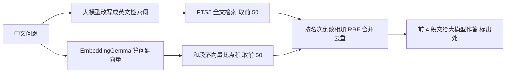

# 导入自己的资料

方舟的资料都装在 `.arkpack` 资料包里。任何人都可以把自己需要的书、手册、网页做成资料包，导入 App 后就能和内置资料一起被检索、被 AI 引用。

本文分两部分：先讲检索架构（为什么这样做），再讲怎么一步步做一个资料包。

## 一、检索架构

### 不训练模型，只算向量

方舟**没有训练任何模型**，包括向量模型。语义检索直接用 Google 现成的 **EmbeddingGemma 2 270M**（`.litertlm`，165 MB，Apache-2.0）：

- **电脑上**：把资料包里每一段文字算成一个 256 维向量，存进资料包。这一步只在打包时做一次。
- **手机上**：只算用户问题的向量（CPU，每次约 0.15 秒），再和资料包里存好的段落向量比相似度。

两边用的是**同一个模型文件、同一套输入格式**，向量才能对得上：

| | 输入格式 |
|---|---|
| 段落 | `title: {书名 › 章节} \| text: {正文}` |
| 问题 | `task: search result \| query: {问题}` |

向量统一做归一化，再压成 int8（每条另存一个 float32 缩放系数），所以每段只占 260 字节，2.5 万段约 6 MB。这个模型支持多语言，中文问题可以直接搜到英文段落。

不选择微调向量模型，原因有两个：现成模型的效果已经够用（见下面的数据）；而且所有资料包共用一个公开模型，别人做的资料包不用重新训练就能直接接入。

### 一次提问的检索流程



- **关键词这一路**：SQLite FTS5 全文索引（英文用 porter 词干）。候选先按“覆盖了几个检索词”排序，再按 BM25 排序。
- **语义这一路**：逐条算点积，2.5 万段只要几毫秒，不需要向量数据库。
- **合并**：两路按名次倒数相加（RRF，k=60），再按段落开头文字去重（同一本书常被多个合集重复收录）。
- 没装向量模型时只走关键词这一路，照样能用。

实测（40 个真实问题）：只用关键词时，前 4 段里有好段落的是 34 题；两路合并后是 36 题。好段落排在第一位的，从 27 题提高到 33 题。

### 中文显示、英文检索

内置的核心包原文是英文，我们用机器翻译生成了中文版：显示给用户、交给模型读的是中文，**全文索引和向量仍然基于英文原文**。英文原文以 zlib 压缩存在包里，阅读器里可以切换查看。我们试过直接用中文译文建索引，评测效果明显变差，所以没有采用（详见 `data/build_zh.py`）。

## 二、资料包格式

`.arkpack` 就是一个 SQLite 文件：

| 表 | 内容 |
|---|---|
| `meta(key, value)` | `id`、`title`、`lang`（en / zh）、`license`、`version`、`chunks`；有向量时还有 `vec_model`、`vec_dim`（必须是 256） |
| `docs(id, path, title, src)` | 文档（一本书或一篇文章） |
| `chunks(id, doc_id, seq, text, title)` | 段落。`seq` 是段落在文档内的顺序，阅读器靠它翻上一段、下一段。正文第一行是“书名 › 章节” |
| `chunks_fts` | FTS5 全文索引。英文包用 `porter unicode61`，中文包用 `trigram` |
| `vec(chunk_id, v)` | 可选。`v` = 4 字节缩放系数 + 256 个 int8 |

App 会自动读取 `Android/data/app.ark.offline/files/packs/` 里的所有 `.arkpack`。每个包可以在「资料」页单独开关。

## 三、自己做一个资料包

需要准备：Python 3.10+；要读 ZIM 文件时还需要 `pip install libzim`，要读 PDF 时需要 `pip install pypdf`；算向量需要 JDK 21 和 Gradle。

### 1. 准备原始资料

`data/extract_chunks.py` 支持以下几种来源：

- **ZIM 文件**（Kiwix 格式，例如维基百科、Stack Exchange、各种离线百科）：直接传 `.zim` 文件路径。
- **一个目录 = 一本书**：目录名就是书名，里面可以放 PDF、HTML、TXT、Markdown（Markdown 的 `#` 标题会被当作章节）。

```bash
python data/extract_chunks.py "path/to/My Field Manual" path/to/wikimed.zim
# 输出 data/chunks/<资料名>.jsonl，每行 {"src", "doc", "title", "text"}
```

脚本会按章节切段（每段约 120–380 个英文词），并在每段开头加上“书名 › 章节”，同时跳过页眉、页码、目录和参考文献。

**中文资料**：这个切段脚本是按英文单词数切的，不适合中文。中文资料请自己写成 jsonl，每段 300–800 字，第一行写“书名 › 章节”：

```python
import json
with open("data/chunks/my-zh.jsonl", "w", encoding="utf-8") as f:
    for doc, title, sections in my_books:          # 自己的数据
        for sec, body in sections:
            f.write(json.dumps(dict(src="my-zh", doc=doc, title=title, text=f"{title} › {sec}\n{body}"), ensure_ascii=False) + "\n")
```

### 2. 打包

```bash
python data/build_pack.py <包id> "<标题>" <en|zh> "<许可说明>" <输出目录> data/chunks/a.jsonl data/chunks/b.jsonl ...
# 例：
python data/build_pack.py my-manuals "我的手册" en "公有领域" data/packs/my data/chunks/My_Field_Manual.jsonl
```

- `包id` 决定文件名，也是 App 里区分资料包的依据：同一个 id 的新版本会覆盖旧版本。
- 多个来源时，排在前面的优先：内容重复（超过 60% 相同）的段落只保留第一次出现的那份。
- 资料是 OCR 扫描件时，可以设置环境变量 `ARK_QMIN=0.8`，把乱码段丢掉。

### 3. 算向量（可选，但强烈建议）

```bash
bash tools/embed/setup.sh                      # 下载 litertlm-jvm.jar 和 EmbeddingGemma 模型
cd tools/embed && gradle installDist && cd ../..
tools/embed/build/install/ark-embed/bin/ark-embed pack models/embed/embeddinggemma-2-text-270m.litertlm data/packs/my/my-manuals.arkpack 256
```

- 维数**必须是 256**，App 只会用这个维数的向量。
- 默认先尝试 GPU，失败自动改用 CPU；也可以设置 `ARK_EMBED_CPU=1` 强制只用 CPU。
- 不算向量的资料包也能用，只是只能按关键词检索：中文问题要先被大模型改写成英文检索词，没有大模型时就基本搜不到英文资料。

### 4. 导入手机

两种方式任选：
- 在 App 的「资料」页点「导入」，选中 `.arkpack` 文件。
- 用数据线把文件拷到 `Android/data/app.ark.offline/files/packs/`。

导入后，资料页会显示包名和段落数，提问时就会一起检索。

### 5. 检查效果

- 直接在 App 的搜索框里搜几个关键词，看能不能搜到你的资料。
- 想量化评测时，可以参考 `eval/hybrid_test.py`、`eval/retr_eval.py`：用一批真实问题跑检索，看前 4 段里有没有能回答问题的段落。

## 四、建议

- **段落开头写清“书名 › 章节”**，检索和模型都靠它判断这段讲什么。
- **一段只讲一件事**：太短的段落缺少上下文，太长的段落会挤掉其他资料（模型每次只读 4 段）。
- **优先放高质量来源**：权威、现代的资料放在前面，过时的做法（比如老军用手册里的“止血带定时松开”）会被模型照抄。
- **写清许可**：`license` 字段会显示在 App 里。公开分享的资料包，请只收录公有领域或允许再分发（如 CC BY-SA）的内容。
