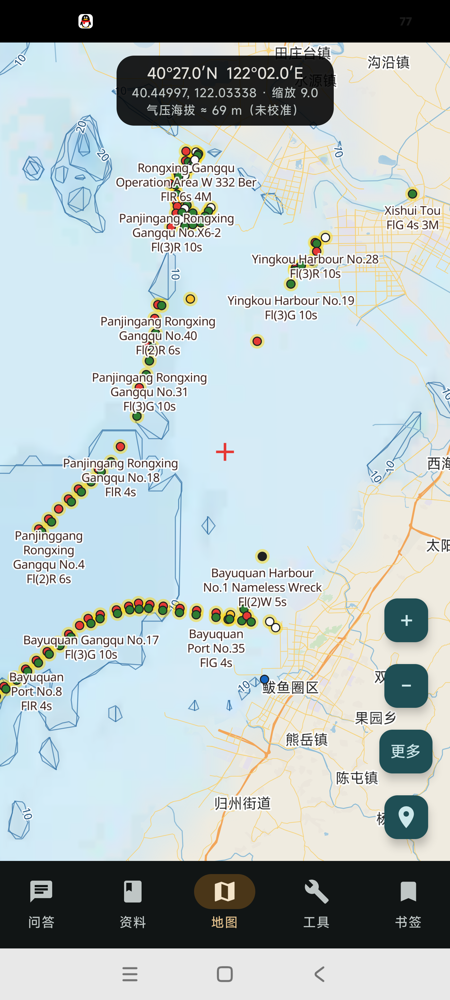
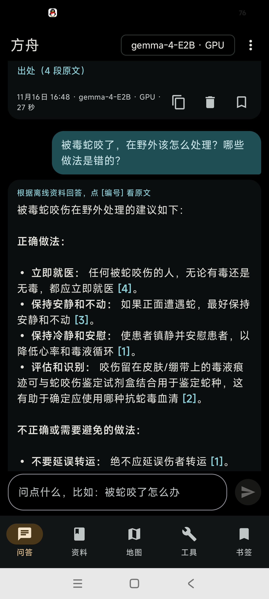
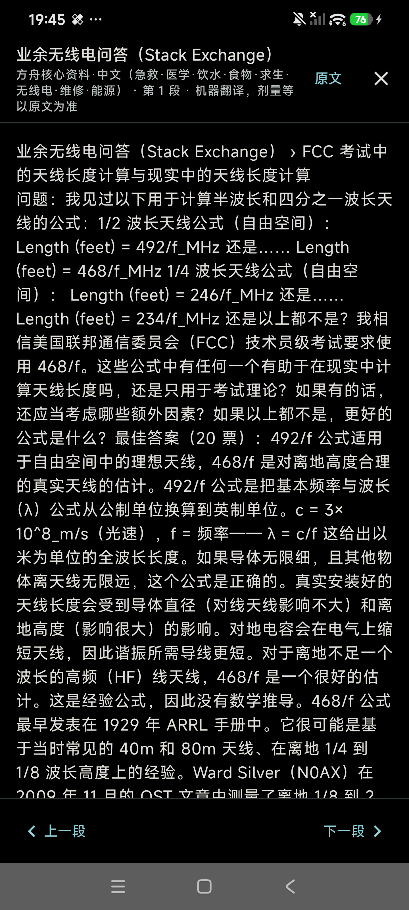
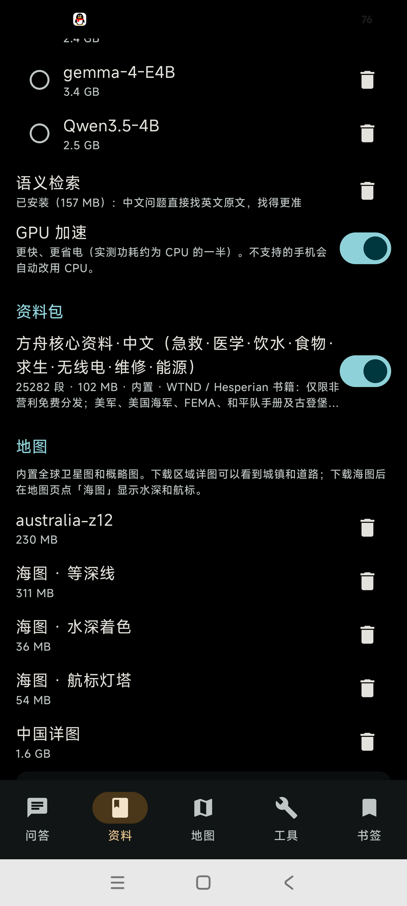
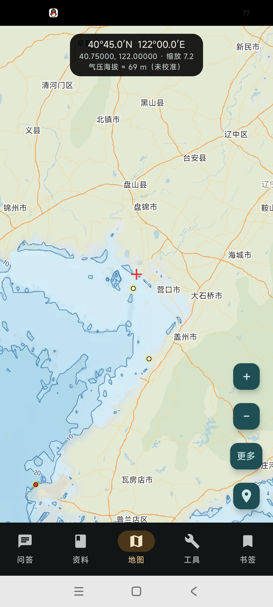
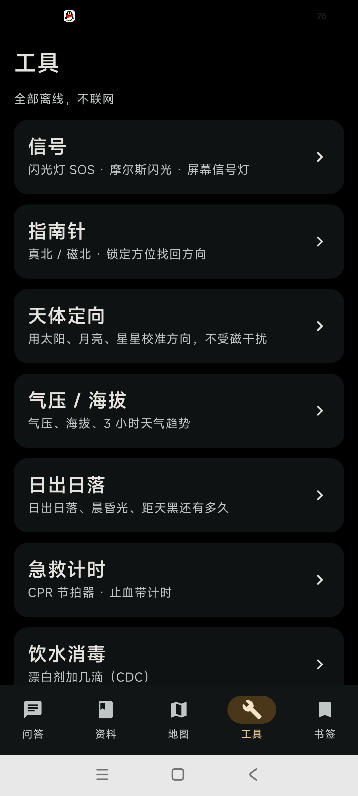
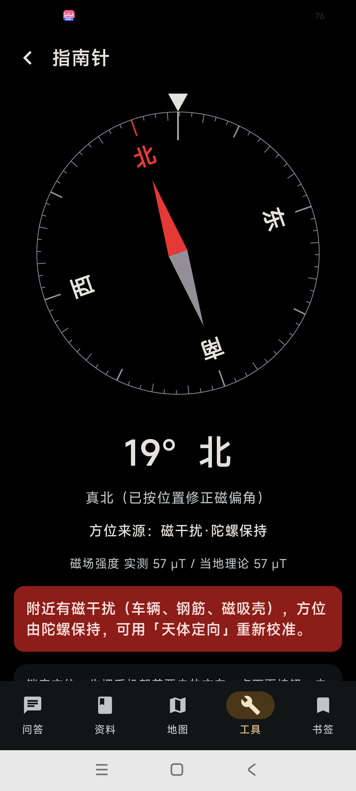
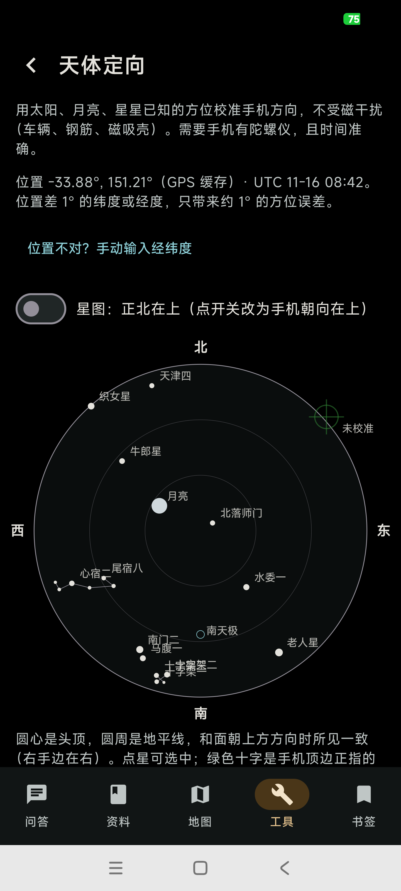

# 方舟 ARK：断网断电也能用的求生手机助手（开源）

停电、断网、没有医生的时候，手机里装着的东西就是你全部的资料。方舟把**一个本地 AI、一套求生资料、全球地图和海图、一组求生工具**放进一个安卓 App，全程不联网。

*营口港、鲅鱼圈和盘锦港航道，全部离线显示。红绿点是航道两侧的浮标，旁边的 `Fl(3)G 10s` 是灯质：绿灯每 10 秒闪 3 次，夜里看到这样的闪法就能对上是哪个浮标。*

## 能做什么

**1. 离线问答，每句都有出处**

AI 模型完全在手机上运行。它先在资料里检索，再根据检索到的内容回答，每句话都标出处编号，点一下就能看原文。武器、自卫、处理野生动物这类求生问题，它照样回答，不会拒答。

 

**2. 资料齐全，中文显示**

内置约 2.4 万段资料，覆盖急救、医学、饮水、食物、野外求生、无线电、机械维修、能源等。资料主要来自美军和 FEMA 手册、Hesperian 医疗书、古登堡计划等可公开分发的来源，界面上可以切换中文译文和英文原文对照。不用 AI 也能直接搜原文，几乎不耗电。

**3. 地图和海图**

- 内置全球卫星图和概略图，GPS 定位不需要网络。
- 11 个区域详图（中国、日韩、东南亚、欧洲、北美等），按需下载。
- 海图：GEBCO 2026 水深着色、全球等深线，以及 OpenSeaMap 的 59 万个航标和灯塔，含灯质。

**4. 求生工具，方向在磁干扰下也稳定**

工具包括闪光灯 SOS 和摩尔斯信号、指南针、气压和海拔、日出日落、CPR 节拍器、止血带计时、饮水消毒剂量和单位换算。

普通指南针靠近车辆、钢筋或磁吸手机壳就会乱指。方舟用陀螺仪保持方向，检测到磁干扰时会提示。磁干扰严重时，可以用「天体定向」校准：用相机把太阳、月亮或亮星对准十字准星，按算出的天体方位校正方向，之后 30 分钟内不再依赖磁力计。

  

## 跑在什么手机上

- 模型：Google Gemma 4 E2B（约 2.4 GB），GPU 加速。
- 小米 12S Ultra（骁龙 8+ Gen 1）一个问题约 20–35 秒答完，每问耗电约 90–120 焦耳（约占满电的 0.2%）。
- 低端机可改用 CPU，速度会慢一些。

## 说明

- AI 可能出错。用药、剂量、急救步骤，请点出处核对原文。
- 海图只供应急参考，不能代替正规航海图。
- 有版权的书没有放进公开版。想加自己的资料，可以按 [docs/DATA.md](DATA.md) 自己导入。

项目开源（Apache-2.0），欢迎试用、提 Issue，也欢迎推荐可以自由分发的资料。

- GitHub：https://github.com/Yu-DaTouX/ARK
- 下载 App：https://github.com/Yu-DaTouX/ARK/releases
- 地图和海图下载：https://github.com/Yu-DaTouX/ARK/releases/tag/maps-2026-11
